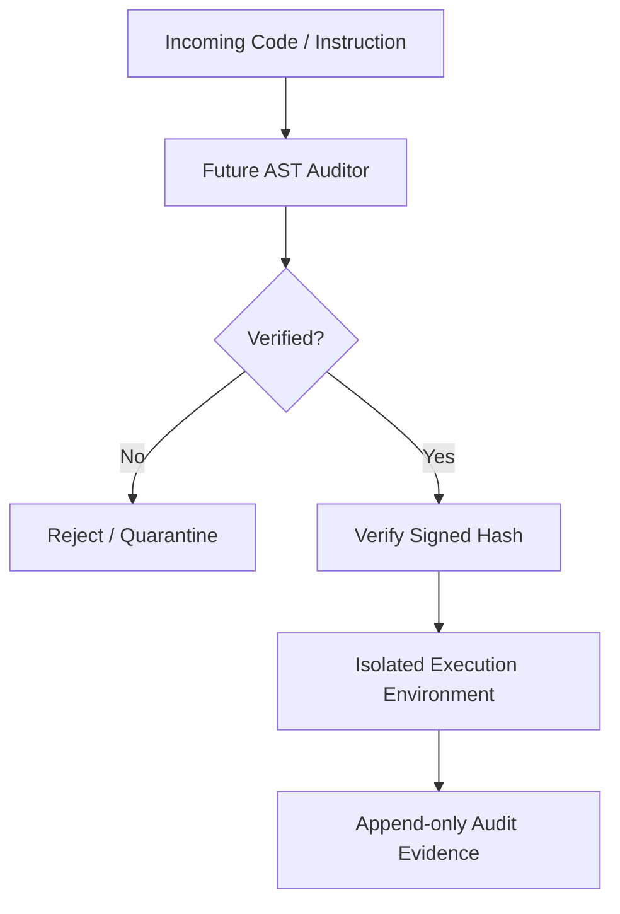

# CLT Global System — Architecture Concept

[](#proof-of-concept--enterprise-customization-readiness)
[](#8-testing--verification)

**CLT Global System is currently a single-README concept repository for a proposed deterministic code-auditing and execution-control layer.**

The current repository contains no source code, AST parser, hash-lock implementation, execution engine, kernel, payment integration, CI workflow, or tests. The architecture below is a proposal, not an implemented security product.

## 1. Project Overview & Problem Statement

The concept explores validating a code or instruction payload before execution, rejecting tampered inputs, and preserving an auditable record of approved execution.

A future implementation would need to define:

- The supported languages and AST parsing rules.
- Canonicalization and cryptographic hash format.
- Trust roots and signature verification.
- Execution isolation and resource limits.
- Audit-log integrity and retention.
- Human override and recovery procedures.

### Conceptual flow



No component in this diagram is currently implemented by this repository.

## 2. Tech Stack & Versions

No language, framework, runtime, parser, cryptographic library, or supported version is selected in the current repository.

Do not infer that the project uses a custom kernel, AST auditor, deterministic execution runtime, or hash-locked execution based on the concept text alone.

## 3. Prerequisites & Dependencies

There are no runtime prerequisites or dependencies for the current documentation-only repository.

A future implementation must document its threat model, parser dependencies, execution isolation model, cryptographic choices, supported platforms, and license compatibility.

## 4. Installation & Local Setup

Clone the repository:

```bash
git clone https://github.com/zopair/CLT_Global_System.git
cd CLT_Global_System
```

There is no application to install, configure, or run. No Dockerfile, package manifest, Python requirements file, or executable entry point is present.

## 5. Environment Variables

No environment variables, API keys, payment credentials, or secrets are defined.

The previous README linked payment-provider badges to an email address. Those links are not payment integrations and should not be interpreted as supported payment channels.

## 6. Usage Guide & Core Features

### Current deliverable

The repository contains only this architecture concept. It does not audit code, detect tampering, lock execution, execute code, or produce security evidence.

### Proposed future capabilities

- AST-based structural validation for explicitly supported languages.
- Canonical content hashing and signature verification.
- Policy evaluation before execution.
- Sandboxed execution with CPU, memory, filesystem, and network boundaries.
- Tamper-evident audit records.
- Human-reviewed exception and recovery workflows.

### Commercial boundary

No payment checkout, Binance integration, InstaPay integration, Vodafone Cash integration, investment portal, or revenue automation is implemented. The prior badges were presentation links only and are not evidence of financial processing.

## 7. Live Demo & Screenshots

No application, dashboard, API, or live security demonstration is deployed. The only current deliverable is the repository README.

## 8. Testing & Verification

No source code, automated tests, CI workflows, static analysis, or deployment configuration is present in the current repository tree.

A future implementation should begin with parser test vectors, tamper-detection tests, hash/signature verification tests, sandbox escape tests, and a reproducible CI workflow before any security claims are made.

## Proof of Concept & Enterprise Customization Readiness

**Status: Concept document only — not a PoC implementation or security product.**

| Capability | Current state |
|---|---|
| Architecture concept | Documented |
| AST auditor | Not implemented |
| Tamper detection | Not implemented |
| Hash-locked execution | Not implemented |
| Secure kernel / sandbox | Not implemented |
| Audit log | Not implemented |
| Payment integration | Not implemented |
| CI / tests | Not present |
| Deployment | Not configured |
| Project license | No root `LICENSE` file present |

### Readiness gates

1. Define the threat model and supported language scope.
2. Implement a small parser/validator with positive and negative test vectors.
3. Add cryptographic signatures and key rotation; hashing alone is not authentication.
4. Execute only inside a separately tested sandbox.
5. Add independent security review before making any deterministic-security or tamper-proof claims.
6. Remove payment and leadership claims until there are verified, authorized implementations.

## Intellectual Property & Authorship

Requested project attribution: **Aly Hussein Zopair (علي حسين زبير ALY HUSSEIN ZOPAIR)**.

**Provenance conflict requiring resolution:** the previous README named `Prince Sultan (Aly Hussein)` and `Al-Zubair Tec Investment` as leadership/organization. This is not independently established by the current source tree. This document does not claim exclusive legal ownership or registration.

This attribution does not create a software license or override third-party intellectual property rights.
